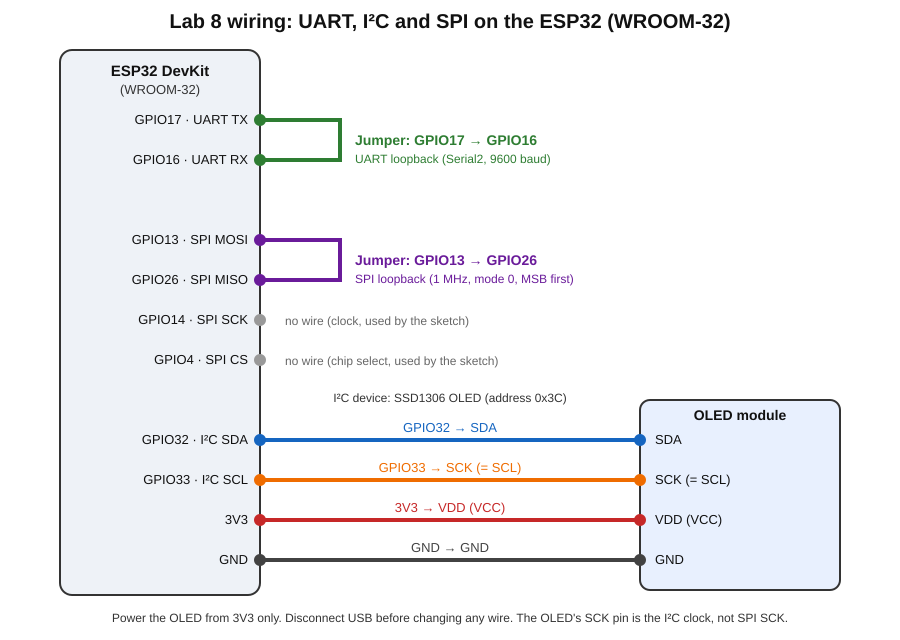
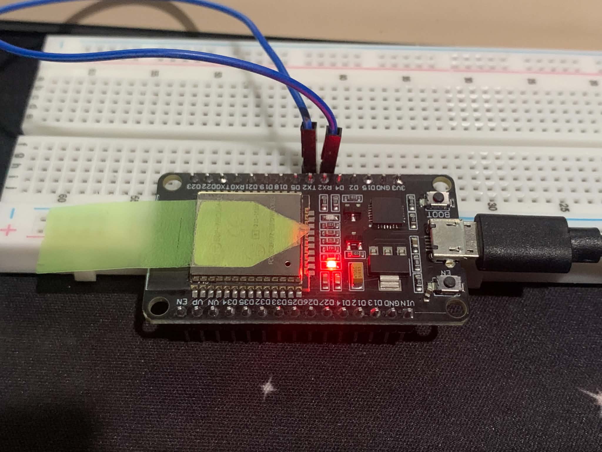
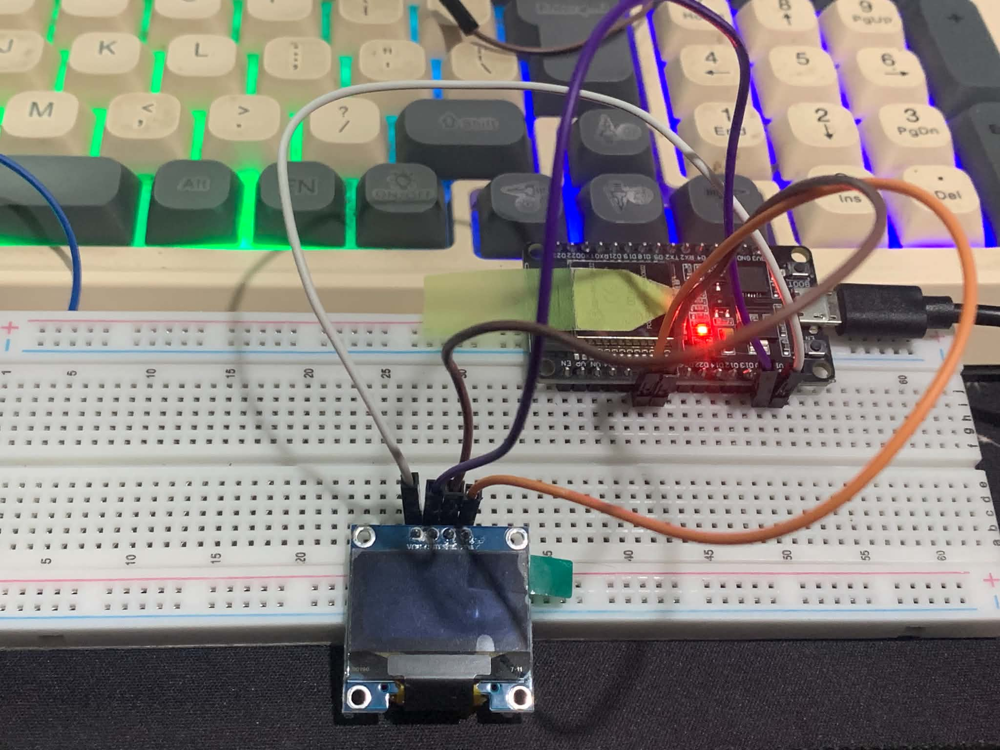
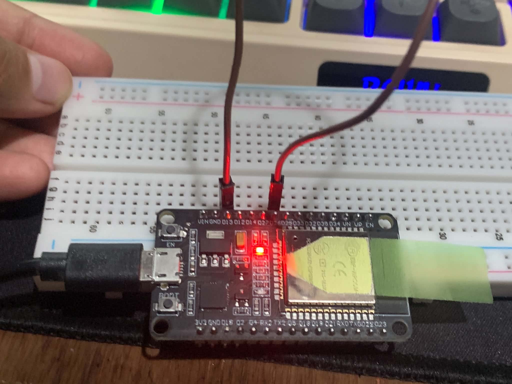
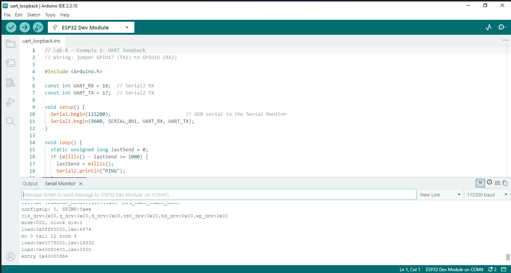
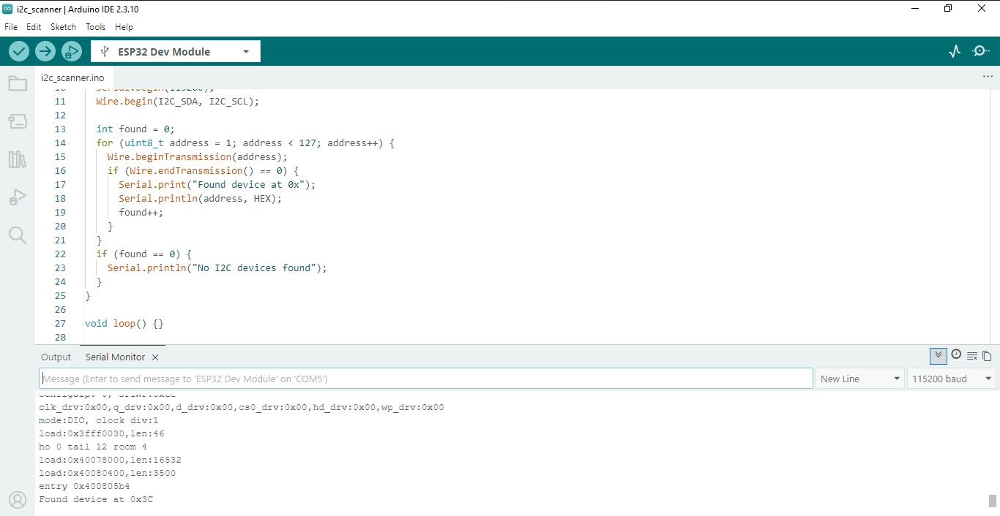
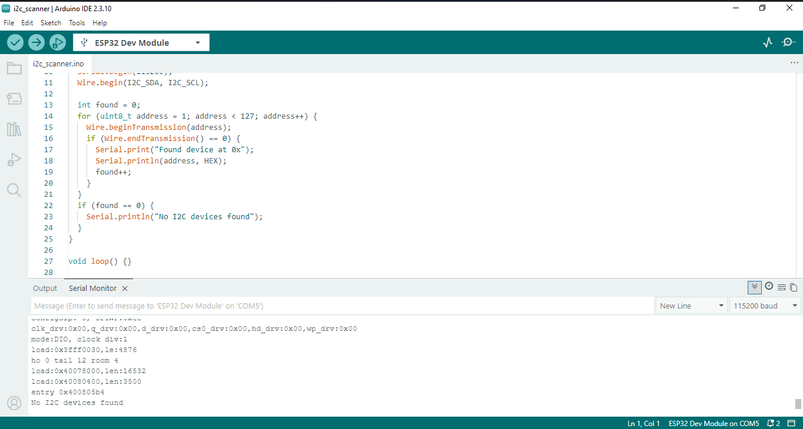
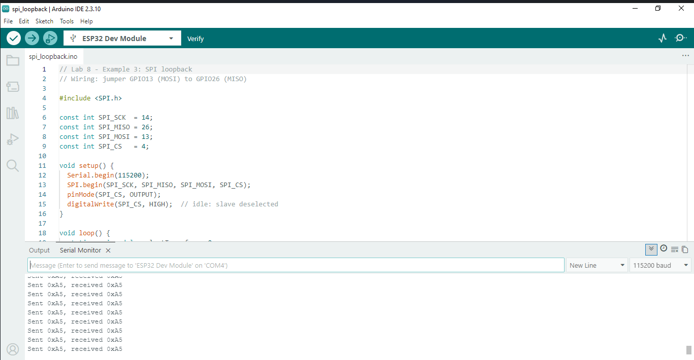
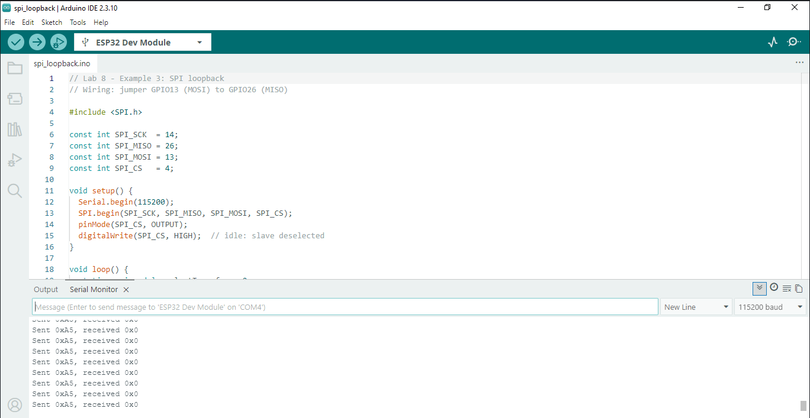
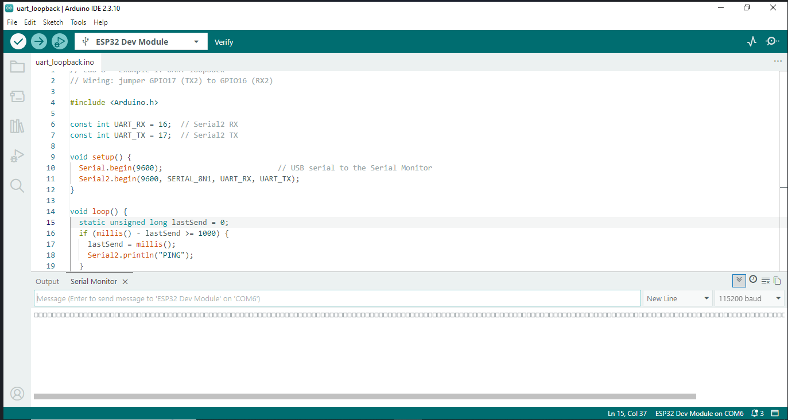

# Laboratory Activity 8 — ESP32 Wired Communication Tests

## Introduction

This activity explores three communication methods available on the ESP32 WROOM-32: Universal Asynchronous Receiver-Transmitter (UART), Inter-Integrated Circuit (I²C), and Serial Peripheral Interface (SPI). Each interface was tested by connecting the required pins or module and comparing the results with the connections removed.

The experiments focus on how data is transmitted and received, how connected devices are detected, and how wiring and serial settings affect communication.

## Equipment and Software

- ESP32 WROOM-32 development board
- USB cable
- Breadboard and jumper wires
- Four-pin SSD1306 OLED module labeled GND, VDD, SCK, and SDA
- Arduino IDE

## Programs Used

| Sketch | Purpose |
|---|---|
| `uart_loopback/` | Transmits `PING` through `Serial2` and prints the bytes received |
| `i2c_scanner/` | Searches I²C addresses from `0x01` to `0x7E` during startup |
| `spi_loopback/` | Transmits `0xA5` using SPI and displays the returned byte |

---

## 1. ESP32 Pin Configuration

The following GPIO pins were assigned to the communication signals for this activity.

| Communication Signal | ESP32 GPIO | Reason for Selection |
|---|---:|---|
| UART TX | 17 | Default `Serial2` transmit pin |
| UART RX | 16 | Default `Serial2` receive pin on the WROOM-32 |
| I²C SDA | 32 | General-purpose, output-capable pin |
| I²C SCL | 33 | General-purpose, output-capable pin |
| SPI SCK | 14 | HSPI clock signal |
| SPI MOSI | 13 | HSPI data output |
| SPI MISO | 26 | Receives the looped-back SPI data |
| SPI CS | 4 | Controls SPI device selection |

Pins associated with flash memory, input-only operation, or boot-strapping were avoided for these signal assignments. GPIO 6–11 were not used because they are associated with the ESP32's onboard flash.

## 2. Circuit Assembly

### Wiring connections

| Connection | Destination | Function |
|---|---|---|
| GPIO17 (TX) | GPIO16 (RX) | Returns UART data to the receiver |
| GPIO13 (MOSI) | GPIO26 (MISO) | Returns SPI data to the input |
| GPIO32 (SDA) | OLED SDA | I²C data connection |
| GPIO33 (SCL) | OLED SCK | I²C clock connection |
| ESP32 3V3 | OLED VDD/VCC | Supplies 3.3 V power |
| ESP32 GND | OLED GND | Common ground |

GPIO14 (SPI SCK) and GPIO4 (SPI CS) are controlled by the SPI sketch but do not have additional wires connected in this loopback setup.

### Circuit diagram

### Photos of the assembled circuits

**UART loopback — TX connected to RX**

**I²C OLED connection**

**SPI loopback — MOSI connected to MISO**

**Important:** The OLED module uses the label `SCK` for its I²C clock connection. For this setup, it connects to GPIO33 (SCL), not GPIO14, which is assigned to the ESP32's SPI clock.

---

## 3. Test Results

Each interface was examined under connected and disconnected conditions. The observations below show whether the received output matched the expected behavior.

| Test Condition | Expected Behavior | Actual Observation |
|---|---|---|
| UART jumper installed | `PING` appears approximately every second | Repeated `PING` lines were displayed |
| UART jumper removed | No received messages appear | No new `PING` lines were printed |
| I²C OLED connected | Scanner detects the module, typically at `0x3C` or `0x3D` | The scanner found a device at `0x3C` |
| I²C OLED disconnected | No device is detected | The program reported `No I2C devices found` |
| SPI jumper installed | Sent and received values are both `0xA5` | The received byte matched `0xA5` |
| SPI jumper removed | The received value no longer reliably matches `0xA5` | The observed value was `0xFF` |
| Sketch at 9600 baud; monitor at 115200 | Output becomes unreadable | Garbled characters appeared |
| Sketch and monitor both at 9600 baud | Output becomes readable again | `PING` appeared correctly |

### UART observations

**With the jumper installed**

The program transmits `PING` through `Serial2` at 9600 baud. Since GPIO17 is connected directly to GPIO16, the transmitted bytes reach the receiver and are printed to the computer through the USB serial connection. The monitor displays the output at 115200 baud.

**With the jumper removed**

The transmitter continues sending data, but the receiver no longer receives those bytes through the loopback connection. As a result, no additional `PING` messages appear. This comparison demonstrates that the jumper provides the return path.

### I²C observations

**With the OLED connected**

The scanner checks the available I²C addresses. It identifies `0x3C`, a common address for SSD1306 OLED modules. The acknowledgment confirms that a device is responding on the bus with the selected SDA and SCL connections.

**With the OLED disconnected**

After removing the module, the scanner no longer receives an acknowledgment from any scanned address. It consequently displays `No I2C devices found`, which is consistent with the module being disconnected.

### SPI observations

**With the loopback jumper installed**

The sketch sends `0xA5` through MOSI while the SPI clock provides eight pulses at 1 MHz. Because GPIO13 (MOSI) is connected to GPIO26 (MISO), the transmitted bits are returned to the input during the transfer. The received value is therefore also `0xA5`.

**With the loopback jumper removed**

When the jumper is removed, MISO is left without a defined signal source. The test produced `0xFF` instead of `0xA5`. A floating input can produce other unpredictable values, so the exact result may vary.

### Serial baud-rate comparison

**Different settings: sketch at 9600 baud, monitor at 115200 baud**

The output becomes unreadable because the sketch and Serial Monitor interpret the timing of the transmitted bits differently. The monitor is configured for a rate much higher than the sketch's selected rate.

**Matching settings: sketch and monitor both at 9600 baud**

After both sides are set to 9600 baud, the `PING` messages become readable again. Following this comparison, the sketch was returned to `Serial.begin(115200)`.

---

## 4. Discussion

### UART: Why must the baud rates match?

UART does not transmit a separate clock signal to synchronize the receiver. Both sides must use compatible baud-rate settings so the receiver can sample the incoming bits at the correct times. When the settings differ, the received characters may be interpreted incorrectly.

SPI works differently because the master supplies a clock signal alongside the data. The receiving side uses that clock to determine when to sample the data.

### I²C: What happens when two devices use the same address?

An I²C controller selects a device using its address. If two devices on the same bus respond to the same address, both may acknowledge the request and attempt to communicate at once. The controller cannot distinguish them by address alone, which can lead to conflicting or corrupted communication.

### SPI: Why is chip select returned to HIGH?

Setting chip select (CS) HIGH deselects the SPI device between transfers. This allows the selected device to stop participating in the current transaction and, for devices that support it, release the MISO line. Bringing CS LOW again begins a new selection period. The exact behavior of internal transfer state depends on the SPI device.

---

## 5. Conclusion

The experiments demonstrated how the three wired communication interfaces behave under different connection conditions. UART successfully returned transmitted messages when TX and RX were connected. The I²C scanner detected the OLED at address `0x3C` and reported no devices when the module was removed. SPI returned the transmitted byte when MOSI and MISO were connected, while removing the jumper produced an unexpected value.

The baud-rate comparison also showed that the Serial Monitor must use a compatible rate to display readable output. Overall, the tests highlighted the importance of correct pin assignments, physical connections, device addressing, and communication settings when working with an ESP32.

